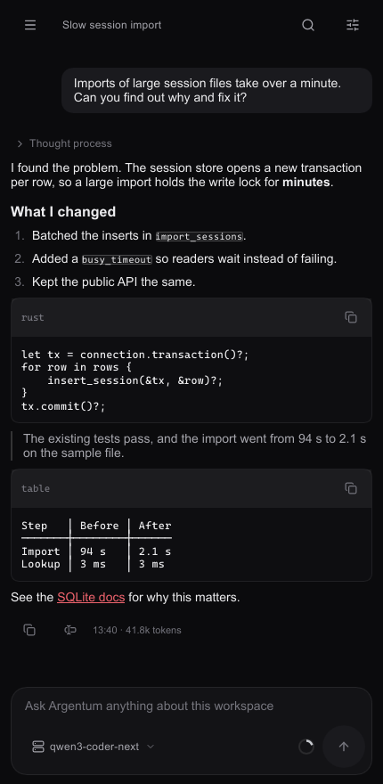
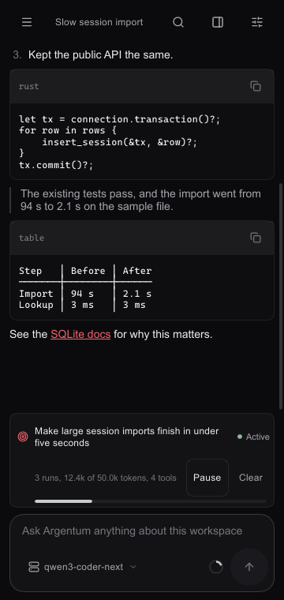
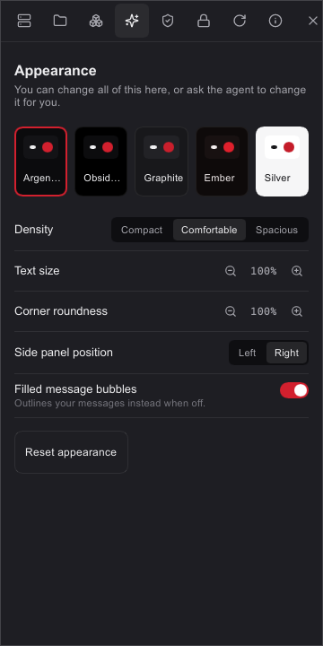

<p align="center">
  
</p>

<h1 align="center">Argentum</h1>

<p align="center">
  <b>A modular agent harness for desktop and mobile.</b><br>
  Native Rust, for Windows and Android, with the Argentum Genesis command-line agent on the same core.
</p>

<p align="center">
  <a href="https://github.com/AG064/argentum/releases/latest"><b>Download</b></a> &nbsp;&middot;&nbsp;
  <a href="docs/SUPPORT_MATRIX.md">Requirements</a> &nbsp;&middot;&nbsp;
  <a href="docs/README.md">Documentation</a> &nbsp;&middot;&nbsp;
  <a href="https://ag064.eu/argentum">Website</a> &nbsp;&middot;&nbsp;
  <a href="#contact">Contact</a>
</p>

<p align="center">
  <a href="https://github.com/AG064/argentum/releases/latest"></a>
  <a href="LICENSE"></a>
  
  <a href="https://github.com/AG064/argentum/actions/workflows/native-cli.yml"></a>
  <a href="https://github.com/AG064/argentum/actions/workflows/codeql.yml"></a>
  <a href="https://scorecard.dev/viewer/?uri=github.com/AG064/argentum"></a>
  <a href="https://www.bestpractices.dev/projects/12957"></a>
</p>


Argentum is an AI coding agent you run on your own machine, with the model you
choose. It reads your project, edits files, and runs commands, and it asks before
it does anything your project's rules do not allow. Approvals, diffs, slash
commands, and sessions work just like you are used to in other harnesses. The
difference is that every part beyond the conversation is a module you can turn
on or off, and the same agent runs natively on your phone.

## Two products, one core

<table>
  <tr>
    <th width="50%"><a href="crates/argentum-app/README.md">Argentum desktop</a></th>
    <th width="50%"><a href="crates/argentum-cli/README.md">Argentum Genesis</a></th>
  </tr>
  <tr>
    <td><a href="crates/argentum-app/README.md"></a></td>
    <td><a href="crates/argentum-cli/README.md"></a></td>
  </tr>
  <tr>
    <td>The native Slint app. It starts with a provider and a conversation. Everything else is an optional module: Git diff, a page reader, usage, goals, and more.</td>
    <td>The CLI and terminal shell, <code>argentum</code>. Chat interactively, run headless tasks with JSON output, or serve JSONL to another program.</td>
  </tr>
  <tr>
    <td><code>cargo run -p argentum-app</code></td>
    <td><code>cargo run -p argentum-cli --bin argentum</code></td>
  </tr>
  <tr>
    <td><b>Download:</b> <a href="https://github.com/AG064/argentum/releases/tag/v0.1.0">0.1.0</a> for Windows x64 and Android arm64</td>
    <td><b>Download:</b> <a href="https://github.com/AG064/argentum/releases/tag/v0.1.0">0.1.0</a> for Windows x64</td>
  </tr>
</table>

Both run on the same native core, which owns providers, scoped policy, guarded file
changes, verification, cancellation, durable history, and recovery. Argentum Genesis
ships in every release next to the apps, and a default CLI build does not include the
desktop code.

## On your phone

The Android app is the same agent, with the same providers, modules, approvals, and
history, in a layout made for touch. It works in its own folder, or in your shared
storage once you allow "All files access", and runs shell commands on the phone with
the same approvals as on a PC. Pair it with your computer to drive one from the other.

<table>
  <tr>
    <td width="33%"></td>
    <td width="33%"></td>
    <td width="33%"></td>
  </tr>
  <tr>
    <td>Replies show what the agent did, with code and tables that fit the screen</td>
    <td>Set a goal, and the agent works toward it within your limits</td>
    <td>Five themes, text size, density, and more</td>
  </tr>
</table>

## Download

Get [Argentum 0.1.0](https://github.com/AG064/argentum/releases/tag/v0.1.0) from the releases page. Nothing else needs installing.
What each system needs, and what has been tested, is in
[systems, requirements and support](docs/SUPPORT_MATRIX.md).

| File | What it is |
| --- | --- |
| `Argentum-0.1.0-windows-x64.msi` | The Windows installer. Start here |
| `Argentum-0.1.0-windows-x64.zip` | The Windows app without installing |
| `Argentum-0.1.0-android-arm64.apk` | The Android app, for 64-bit ARM phones with Android 9 or later |
| `argentum-genesis-0.1.0-windows-x64.zip` | Argentum Genesis, the command-line agent |
| `argentum-genesis-desktop-control-0.1.0-windows-x64.zip` | Argentum Genesis with Windows desktop control, extensions, and MCP |
| `SHA256SUMS.txt` | Checksums for every file |

The Windows files are not code signed, so Windows SmartScreen may warn the first time. Choose
**More info**, then **Run anyway**. The installer needs no administrator rights. On Android,
allow your browser or file manager to install apps when asked.

Check a download with `Get-FileHash FILE` and compare it with `SHA256SUMS.txt`. Check where it
was built with `gh attestation verify FILE --repo AG064/argentum`.

## What sets it apart

- **Modular:** it starts as a conversation and a model picker. Sessions, Git diff,
  goals, usage, the context meter, and the rest are modules you turn on when you want
  them.
- **Native on desktop and phone:** one Rust core with a native interface on Windows and
  Android. The Android app runs the agent on the phone itself.
- **Any model:** more than 40 provider presets, local models, and any
  OpenAI-compatible server.
- **Local first:** your projects, sessions, and history stay on your device. There is
  no telemetry, and updates contact GitHub only when you ask.
- **You stay in control:** the saved project policy decides what the agent can do.
  Prompts, model output, and remote content cannot grant it more.
- **Durable history:** sessions and runs survive restarts, and recovery after a crash
  is explicit, never automatic.

## How it compares

| | Argentum | Codex CLI | Claude Code | Pi | DeepSeek Harness |
| --- | --- | --- | --- | --- | --- |
| License | AGPL-3.0 | Apache-2.0 | Proprietary | MIT | MIT |
| Written in | Rust | Rust | TypeScript | TypeScript | TypeScript |
| Models | Over 40 presets, local models, any OpenAI-compatible server | OpenAI models, others through configuration | Anthropic models | Many providers | Many providers |
| Native app on Windows | Yes | Separate app | Separate app | Terminal only | Separate Electron app |
| Agent runs on an Android phone | Yes, native app | No | No, remote sessions only | No | No |
| Interface | Every panel is an optional module | Fixed | Fixed | Minimal, extensible | Swappable runtime plugins |
| Terminal agent | Argentum Genesis | Yes | Yes | Yes | Yes (`dsh`) |

This comparison is drawn from each project's public documentation in November 2026.
Corrections are welcome as an issue.

**Benchmarks:** [`benchmarks/`](benchmarks/README.md) holds a harness that runs Argentum
Genesis, Codex, Claude Code, OpenCode, and Pi on the same tasks with the same model.
DeepSeek Harness is left out of the public task set because it uploads session logs
to DeepSeek by default, which that task set's data rules do not allow.
No results have been published yet. They will be added here once the runs are done.

## See what it did

Each response starts with one line saying what the agent did, with the size of the change. Open
it for the exact steps, and open a file to read its diff in place.


From a real run with DeepSeek:

```text
> Thought process
v Changed app.py, read 2 files, listed a folder, ran a command  +6
    Read app.py
    Listed the project folder
    Applied a patch
    Ran `python app.py`
    Read app.py
v app.py  +6
```

```diff
@@ -1,4 +1,5 @@
 def add(a, b):
+    """Return the sum of a and b."""
     return a + b

@@ -6,5 +7,10 @@
     return a - b

+def multiply(a, b):
+    return a * b
+
+
 print(add(2, 3))
 print(subtract(5, 3))
+print(multiply(2, 3))
```

The terminal shows the same steps as they happen:


Details are for your screen only. Command text is not saved, so after a restart you keep the
answer and the recorded changes, and the step list is gone.

## Features

### How a task runs

| Step | What happens |
| --- | --- |
| 1. You ask | Your message and the project's instructions go to the model, inside a checked context budget |
| 2. The model works in rounds | Each round is one model request, and it can make up to 8 tool calls |
| 3. Policy decides | The saved project policy allows a tool, asks you first, or refuses it. Nothing the model says can change that |
| 4. You see each step | Reads, searches, commands, and edits appear as they happen, and thinking streams above them |
| 5. Changes are recorded | Each edit is checked against the source the agent read, and saved so you can review or restore it |
| 6. It stops | A run ends with an answer, at Esc or `/stop`, at the limit of 120 rounds, or when the model asks for the same tool calls four rounds in a row. Long tasks can be continued, or run as a goal |

### Goals

Give a session one objective, and let it work across several runs within limits you set.


```powershell
argentum goal set "Migrate the parser and keep the tests passing" --token-budget 1000000 --tool-budget 200 --time-budget 3600
argentum goal status
argentum goal supervise
```

You can amend limits, require verification runners, attest completion, pause, resume, and clear a
goal. `goal deliver` runs a finite goal in stages. See [goal accounting](docs/GOAL_ACCOUNTING.md).

### Providers and models

The catalog covers hosted services, aggregators, your own server, and local models:

| Type | Providers |
| --- | --- |
| Tested with Argentum | DeepSeek, OpenCode Go |
| Hosted | Anthropic, OpenAI, Azure OpenAI, Google Gemini, MiniMax, Groq, Mistral, xAI, Cerebras, Perplexity, Cohere, Moonshot, Z.AI, Qwen, SambaNova, NVIDIA NIM |
| Plans | ChatGPT plan, with browser sign-in |
| Aggregators | OpenRouter, Together, Fireworks, GitHub Models, OpenCode Zen, DeepInfra, Novita, Hugging Face, Chutes, Venice, Avian, Requesty, Vercel AI Gateway, Nebius, Hyperbolic, SiliconFlow, Featherless |
| On your computer | llama.cpp, LM Studio, Ollama, vLLM |
| Your own | Any OpenAI-compatible server |

Every preset, with its address, default model, and key variable, is listed in
[docs/PROVIDERS.md](docs/PROVIDERS.md).

- **Thinking:** choose Off, Low, High, or Max from the composer, or with `/thinking`. Only the levels the model supports are offered.
- **Secure keys:** API keys go in the operating system's credential store, and each is only sent to its provider's own address.
- **Tested and Testing tabs:** Settings > Providers lists tested providers first, and the rest on a Testing tab, so you know which have not been run against Argentum. First run shows only tested providers until you choose Show all.


### Context and budget

Change these in Settings > Providers, or with `argentum provider budget`:

- **Budget:** total, input, output, and uncertainty limits for each model. Models with known limits work without setup.
- **Context size:** pick the size for a local model in the app, under Context size.
- **Context meter:** an optional module showing how full the session's context is and the tokens it has used. The terminal footer always shows it.
- **Compaction:** when the next request would not fit, a run summarizes earlier work and continues. You can also run `argentum compact` yourself. The summary loses detail, and Argentum tells you when one is in use.

A request that would not fit is refused before it is sent.

### Control and safety

- **Permission profiles:** Observe, Guided, Automatic, Verification, Developer, and Full Access. Guided is the default.
- **Clear approvals:** a prompt shows the exact action and target, and you can approve once or reject.
- **Guarded edits:** an edit must match the exact source the agent read. A stale or ambiguous edit is rejected.
- **Review and restore:** look through the files a run changed, then restore them, checking first that they have not changed since.
- **Verification:** fixed runners produce receipts tied to the source they checked.
- **Recovery:** after a crash, `argentum recovery inspect` shows what happened, and takeover is never automatic.

### Desktop app

- **Modules:** turn on only what you want: Sessions, Context meter, Reasoning, Goal, Command palette, Status bar, Changes, Git diff, Browser, Usage, Plan, Activity, and Trajectory.
- **Sessions:** search, rename, pin, archive, and fork.
- **Themes:** Argentum, Obsidian, Graphite, Ember, and Silver, plus density, text size, corners, colors, and fonts.
- **Interface tools:** the agent can adjust the interface when you approve it, and can never touch permissions or the approval prompt.
- **Updates:** contacts GitHub only when you click, checks the SHA-256 sum, and rolls back if installing fails.


### Terminal and automation

| Mode | Command | For |
| --- | --- | --- |
| Chat shell | `argentum chat` | Interactive work with selectable panels |
| Headless | `argentum run --prompt TEXT --json` | One task, streamed as JSON |
| Server | `argentum serve` | JSONL on stdin and stdout, for other programs |

`argentum run` cannot approve its own actions, so a task that needs you fails with
`approval_required`. Use `--final-result` for one settled result, and `--answer-schema` to check the
answer against a schema.

### Optional at build time

Extensions, MCP, a browser adapter, desktop control, and local artifacts can be built in. A default
CLI build leaves them out.

### Known limits

- A run stops after 120 rounds, and earlier if the model repeats the same tool calls four rounds in a row.
- The steps and diff list on each response last for the running session only.
- Releases are built for Windows x64 and Android arm64. The CLI builds from source on Linux and macOS, without release files yet. See [Argentum on Android](docs/ANDROID_HOST.md).
- Selecting part of a reply on Android places one cursor at a time. Copy takes the whole reply.

## Build from source

You need Rust 1.98.0, Git, and on Windows the MSVC C++ build tools. No Node.js is
needed.

```powershell
git clone https://github.com/AG064/argentum.git
cd argentum
cargo run -p argentum-app
```

For the terminal product, and for setup details, see
[its page](crates/argentum-cli/README.md).

## Project status

0.1.0 is the first stable release, for Windows x64 and Android arm64. The CLI builds from
source on Linux and macOS, without release files yet, and iOS is a later target.

| Read this | For |
| --- | --- |
| [Support matrix](docs/SUPPORT_MATRIX.md) | What each platform and provider supports |
| [Roadmap](ROADMAP.md) | What comes next |
| [Security policy](SECURITY.md) | The trust boundary, and how to report a vulnerability privately |
| [All documentation](docs/README.md) | Guides and architecture |

## Repository layout

| Path | What |
| --- | --- |
| [`crates/argentum-app`](crates/argentum-app/README.md) | Desktop host |
| [`crates/argentum-cli`](crates/argentum-cli/README.md) | Genesis CLI and terminal shell |
| [`ui/`](ui/) | Slint interface, tokens, and icons |
| [`crates/`](crates/) | Shared runtime, store, tools, providers, and security |
| [`platforms/`](platforms/README.md) | Native platform targets |
| [`docs/`](docs/README.md) | Documentation |

## Contact

Questions, ideas, contributions, and legal or business inquiries, including commercial
licenses: write to [contact@ag064.eu](mailto:contact@ag064.eu). Argentum is made by
AG064; more projects are at [ag064.eu](https://ag064.eu).

Report security problems privately as described in [SECURITY.md](SECURITY.md), and
everything else as a [GitHub issue](https://github.com/AG064/argentum/issues).
Official support covers the released app and CLI; help with your own extensions,
widgets and modules is given when time allows. See
[what is supported](docs/SUPPORT_MATRIX.md#what-is-supported).

## Support Argentum

Argentum is free and stays free. Support pays for Windows code signing, so Windows
stops warning on install, a Google Play listing, and test devices. You can help on
[GitHub Sponsors](https://github.com/sponsors/AG064),
[Patreon](https://www.patreon.com/ag064), where the free tier gets every public update, or
with a one-time tip on [Ko-fi](https://ko-fi.com/ag064).

## Contributing

Issues and pull requests are welcome. Contributions need the
[contributor agreement](CONTRIBUTOR_AGREEMENT.md), and [CONTRIBUTING.md](CONTRIBUTING.md)
describes the checks to run.

## License

Argentum is free software under the [GNU Affero General Public License 3.0](LICENSE)
(`AGPL-3.0-only`), with the additional terms in [NOTICE.md](NOTICE.md): keep the
attribution, and mark modified versions as modified. If you run a modified version for others
over a network, you must offer them its source. Commercial licenses without these terms are
available from contact@ag064.eu.

The Argentum name and logo are covered by the [trademark policy](TRADEMARKS.md).
Third-party components keep their own licenses, listed in
[THIRD_PARTY_NOTICES.md](THIRD_PARTY_NOTICES.md).
