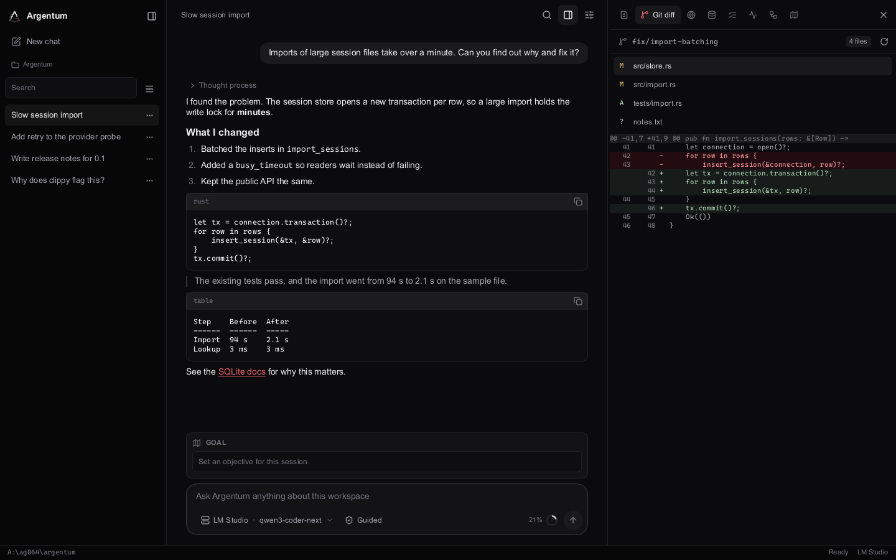
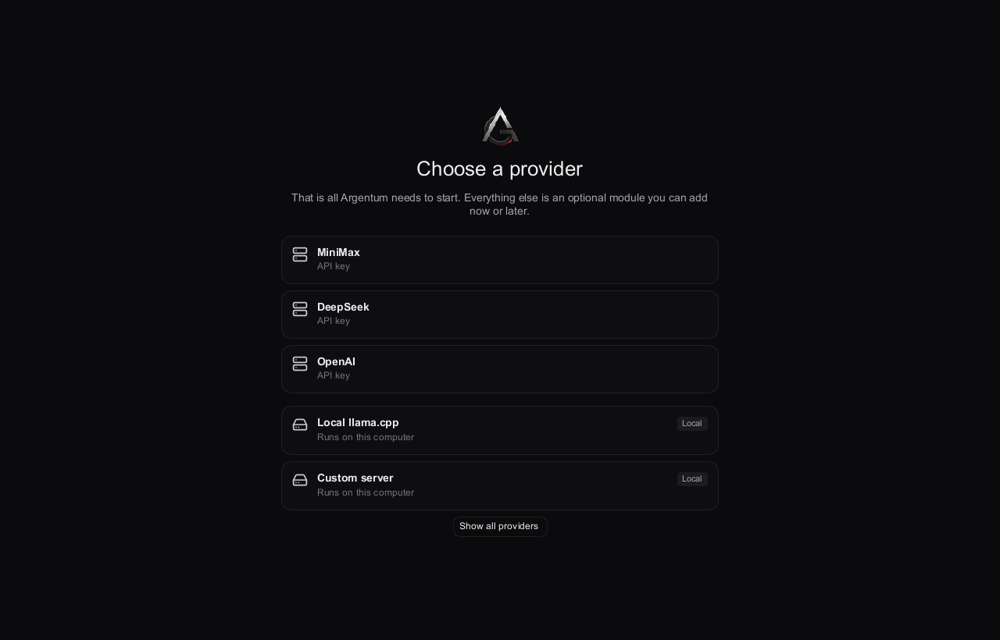
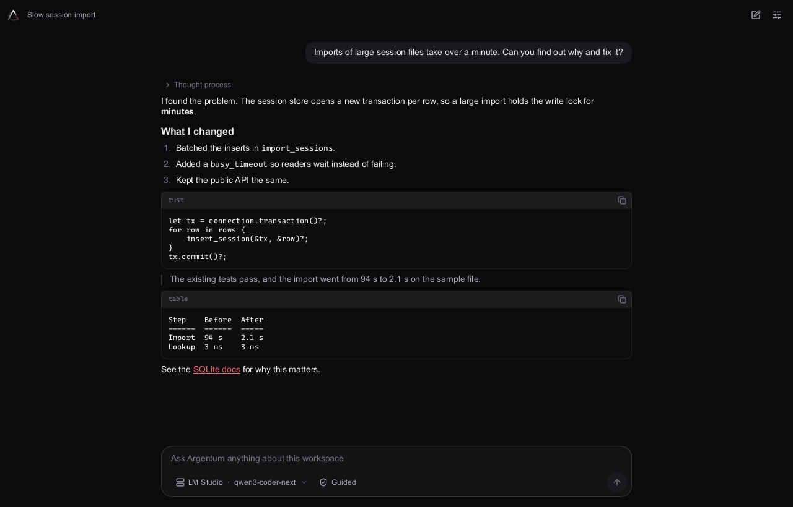
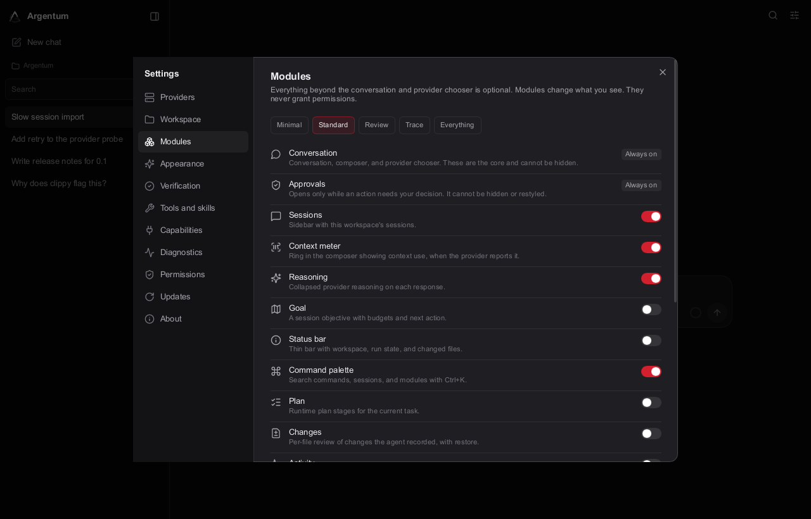
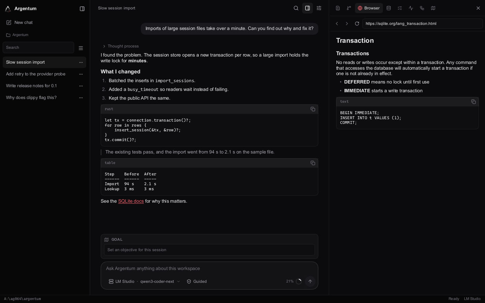
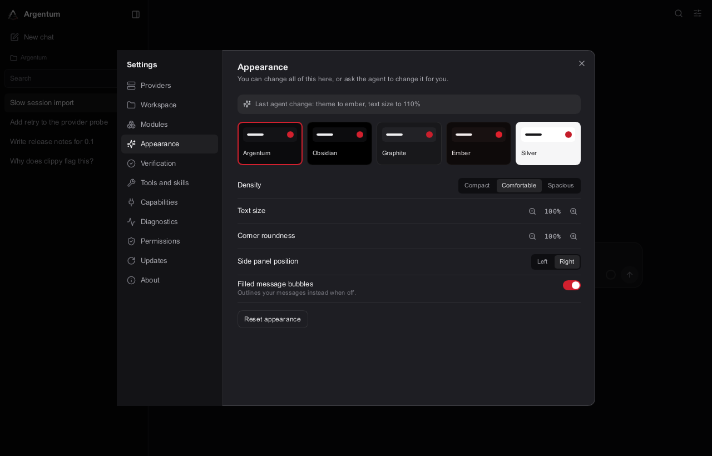
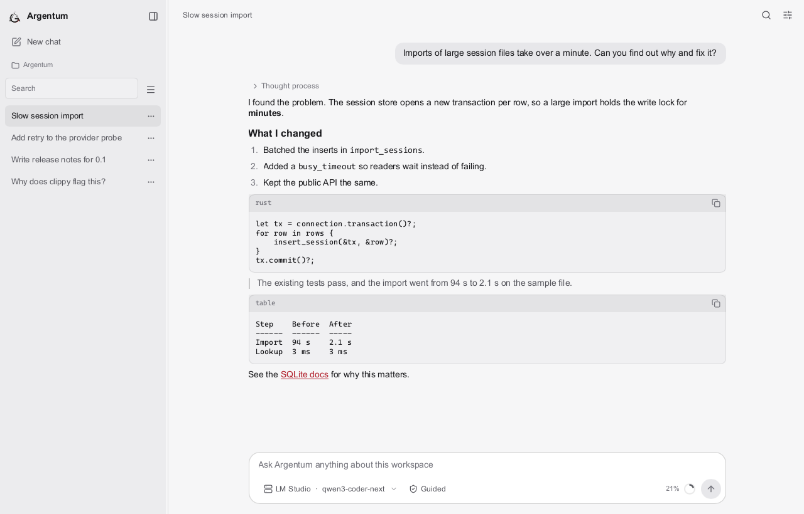
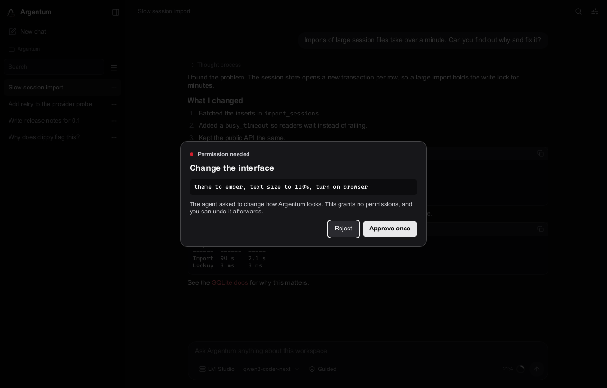
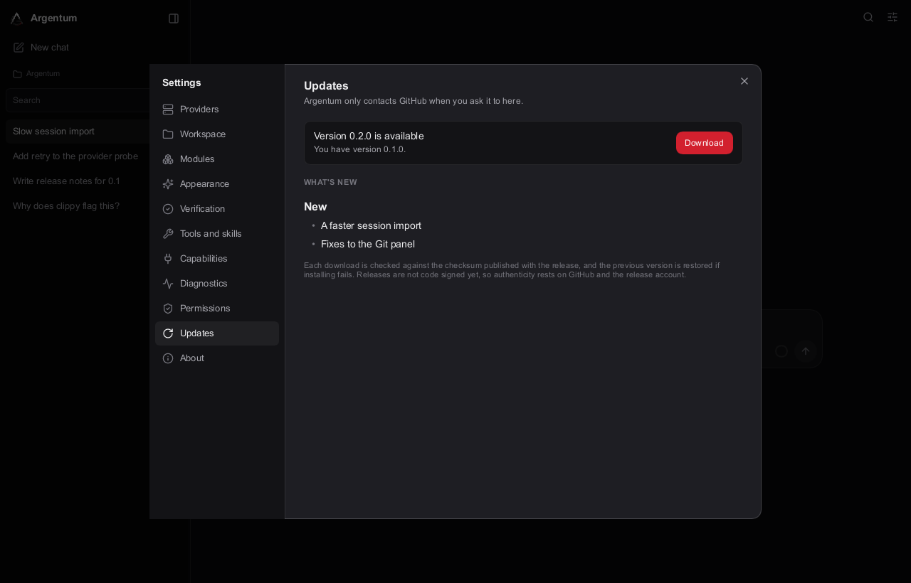

# Argentum desktop

Argentum is the native desktop app for working with an AI coding agent on your own
machine. It is written in Rust and [Slint](https://slint.dev), with no web view and no
JavaScript runtime. It starts minimal and grows with optional modules.

[Back to the project overview](../../README.md) |
[Argentum Genesis CLI](../argentum-cli/README.md) |
[All documentation](../../docs/README.md)



Screenshots on this page come from the app's real interface code, rendered with
sample data by
[`ui_snapshot`](../argentum-ui/examples/ui_snapshot.rs). The conversation, files,
and model names in them are examples.

## Status

Download [Argentum 0.1.0](https://github.com/AG064/argentum/releases/tag/v0.1.0) for Windows x64,
as the installer `Argentum-0.1.0-windows-x64.msi` or the zip `Argentum-0.1.0-windows-x64.zip`.
The same interface ships for Android as `Argentum-0.1.0-android-arm64.apk`; see
[Argentum on Android](../../docs/ANDROID_HOST.md). The Windows files are not code signed, so
Windows may warn the first time.

## Run it

You need Rust 1.98.0, Git, and the Windows MSVC C++ build tools.

```powershell
git clone https://github.com/AG064/argentum.git
cd argentum
cargo run -p argentum-app
```

To use a separate data folder and workspace, for example while trying it out, set
both before starting. `ARGENTUM_DATA_DIR` must be an absolute path.

```powershell
$env:ARGENTUM_DATA_DIR = 'C:\state\argentum-trial'
$env:ARGENTUM_WORKSPACE = 'C:\projects\example'
cargo run -p argentum-app
```

The app carries the C runtime it needs, so a clean PC does not need the Visual C++ runtime
installed.

## First run

A new project asks for one thing: a provider. That can be a hosted service, an
aggregator, a local llama.cpp model, or your own server. API keys go in the operating
system's secure store.



After that you get a conversation. The core is always there and has no switch: the
conversation, the provider and model chooser, and the approval prompt. The model chooser shows
the name the provider gives what is running. Each response starts with one line
saying what the agent did, like "Changed app.py, read a file, ran a command". Open it
for the exact steps, and open a file to read its diff in place. With DeepSeek, the
Thinking chip next to the model switches between off, high, and max.



## Modules

Everything else is an optional module, and only reasoning starts on. Turn them on one by one
in Settings, or pick a set: Minimal, Standard, Review, Trace, or Everything.

| Module | What it adds |
| --- | --- |
| Sessions | Sidebar with this workspace's sessions, search, rename, pin, archive, and fork |
| Context meter | How full the session context is and the tokens the session used, when the provider reports them |
| Reasoning | Thought process, step summary, and changed files with diffs on each response |
| Goal | A session objective with limits and supervision |
| Command palette | The Commands button (Ctrl+K on a keyboard) searches commands, modules, themes, and sessions |
| Status bar | Workspace, run state, changed files, and provider |
| Changes | Files the agent changed, with a per-file diff and restore |
| Git diff | Working tree status and diffs from Git |
| Browser | A script-free page reader |
| Usage | Tokens reported per provider |
| Plan | Plan stages for the current task |
| Activity | Recent run, tool, and approval events |
| Trajectory | Durable records for one session |



A module changes what you see. It never grants permission. The capability behind it
is decided separately by the saved project policy, so Git runs only after a click
and only when `git.read` allows it. The Browser fetches only after a click and only
when `browser.reader` allows it, which is off by default. See
[Interface modules](../../docs/UI_MODULES.md).

The Browser is a reader, not a web engine. It runs no scripts, keeps no cookies, and
never passes pages to the model, so sites that need JavaScript will not work in it.



## Make it yours

There are five themes (Argentum, Obsidian, Graphite, Ember, and Silver), plus density,
text size, corner roundness, side panel position, individual colors, and fonts.

|  |  |
| --- | --- |

## The agent knows the interface

The agent can read how the interface is set up with `ui_inspect` and change it with
`ui_update`. Every change asks first and can be undone. It cannot change
permissions, hide or restyle the approval prompt, or set unreadable colors.



## Settings

Settings also holds what the agent can do and how you check on it:

- **About:** the version, the project acknowledgement, and the Slint credit
- **Providers:** the full catalog, API keys, budget, and context size
- **Workspace:** the current project folder
- **Verification:** runners and their results
- **Tools and skills:** what is registered and available
- **Capabilities:** optional browser and desktop capability status
- **Diagnostics:** accounting, context, compaction, instructions, and run details
- **Permissions:** approval scopes and revoking grants
- **Updates:** check, download, verify, and install

## Updates

Settings > Updates contacts GitHub only when you click. It checks the SHA-256 sum
published with the release, installs, and rolls back if installing fails.

The Windows files are not code signed, so the checksum proves the download is intact,
not who made it. To check where a file was built, run
`gh attestation verify FILE --repo AG064/argentum`.



## Good to know

- **Renderer:** the app draws with the CPU by default on Windows. The GPU renderer
  shows a blank window on some graphics drivers. Set `SLINT_BACKEND` to choose another.
- **Recovery:** if the app did not close cleanly, the next start stops and names the
  command to run, `argentum recovery inspect`. It never takes over by itself.
- **Database upgrades:** opening an older database upgrades it, and older builds cannot
  open it afterwards. Back up your data folder first.
- **ChatGPT sign-in:** it runs only from a terminal, with `argentum provider login chatgpt`.

## Where the code is

| Path | What |
| --- | --- |
| [`ui/workbench/`](../../ui/workbench/) | The Slint interface |
| [`crates/argentum-ui/`](../argentum-ui/) | Binds the interface to the runtime, with the snapshot tool |
| [`crates/argentum-app/`](.) | The desktop host |
| [`crates/argentum-gitview/`](../argentum-gitview/) | The Git diff module's backend |
| [`crates/argentum-browser/`](../argentum-browser/) | The page reader |
| [`crates/argentum-update/`](../argentum-update/) | Update checks and installs |

Design rules are in [Design system](../../docs/ARGENTUM_DESIGN_SYSTEM.md). To
regenerate the screenshots, run:

```powershell
cargo run -p argentum-ui --example ui_snapshot -- OUTPUT_FOLDER
```
