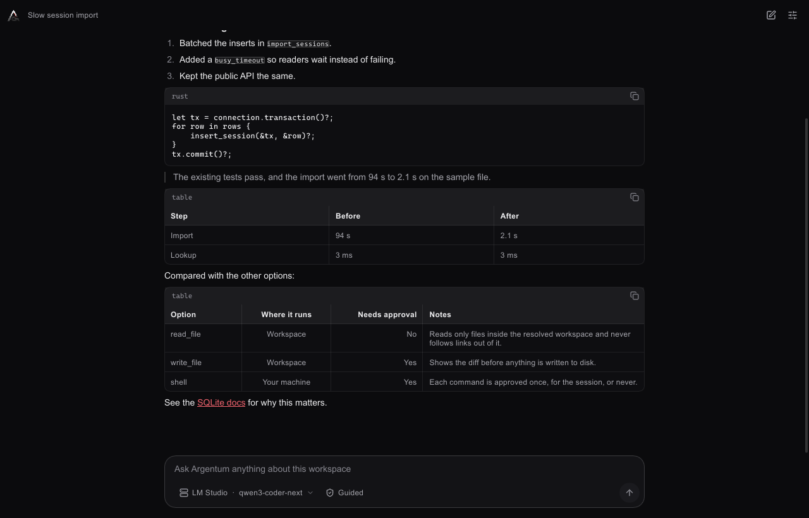

# Argentum documentation

Argentum is an AI coding agent that runs on your own computer or phone, with the
model you choose. It reads your project, edits files and runs commands, and it asks
before it does anything your project's rules do not allow.

These pages are short, task-based guides. Each one takes a few minutes and ends
with something working. The full reference guides stay in the repository, and
every page here links to the one it builds on.

## Start here

1. Install Argentum on [Windows](install/windows.md) or [Android](install/android.md).
2. [Choose a project folder](first-run.md) on the first run.
3. [Add a provider](providers.md), or [run a local model](local-models.md).
4. Read [project policy and approvals](policy-and-approvals.md) so you know what
   the agent can do without asking.

## Then

- Give a longer task a [goal](goals.md) with limits.
- Keep long sessions small with [compaction and budgets](compaction-and-budgets.md).
- Turn on the [modules](modules.md) you want, such as Git diff or Usage.
- [Pair your phone](pairing.md) with your computer.
- Script Argentum with [the command line](cli.md) and [the JSONL server](jsonl-server.md).

If something goes wrong, see [troubleshooting](troubleshooting.md).

## This site does not track you

There are no analytics, cookies, web fonts or scripts from other hosts on this
site. See [about this site](about-this-site.md).
