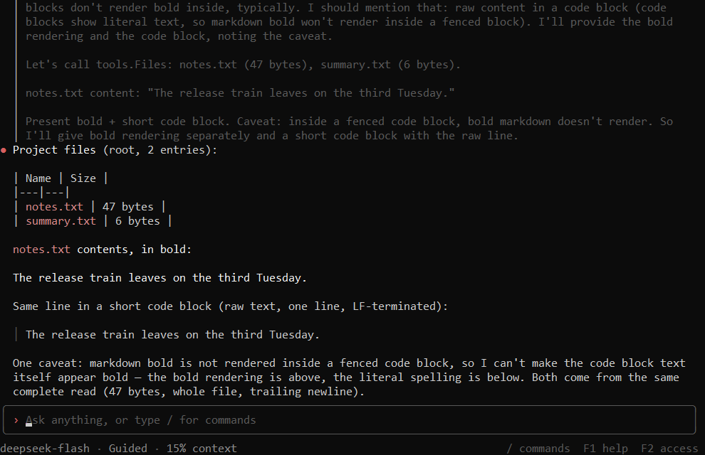
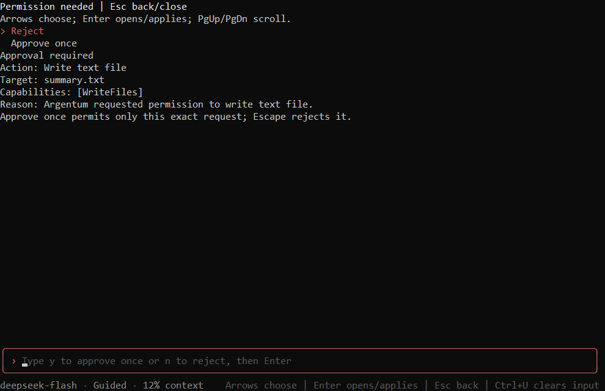

# The command line

Argentum Genesis, the `argentum` command, is the same agent in a terminal. It ships
with the Windows installer and as its own zip. Use it to chat, to run one task and
get JSON back, or to inspect what happened.



## Set up a project

Pick one project folder and one database file and use them for every command on
that project. The folder you run the command from is not the agent's workspace.

```powershell
$ws = 'C:\path\to\project'
$db = 'C:\path\to\argentum.sqlite3'
argentum setup --workspace $ws --database $db
argentum status --workspace $ws --database $db --json
```

`setup` walks you through choosing a provider. `status` checks local settings only
and does not contact the provider.

## Chat

```powershell
argentum chat --workspace $ws --database $db
```

Useful commands inside chat:

| Command | What it does |
| --- | --- |
| `/help` | Lists the session commands |
| `/providers`, `/models` | Pick a provider or model |
| `/new`, `/sessions`, `/resume SESSION_ID` | Start, list or reopen sessions |
| `/steer TEXT` | Adds your text to the running task at its next step |
| `/stop` or Esc | Cancels the run and waits for its work to finish |
| `/compact` | Summarizes the session to free context |
| `/changes` | Reviews recorded changes and verification |

When the agent needs approval, the terminal asks.



## Run one task

```powershell
argentum run --prompt 'Add a unit test for the parser' --workspace $ws --database $db --json
```

With `--json`, a failure prints exactly one JSON object, so scripts can rely on it.

## Check the setup

```powershell
argentum doctor --workspace $ws --database $db --json
```

`doctor` is read-only. It reports the database, project, provider and recovery
state, and contacts nothing.

## Find a command

`argentum commands` lists every command with a one-line summary.
`argentum --help` shows the options.

The full guide is the
[command-line guide](https://github.com/AG064/argentum/blob/development/docs/CLI_GUIDE.md),
and the stable output formats are in
[CLI contracts](https://github.com/AG064/argentum/blob/development/docs/CLI_CONTRACTS.md).
