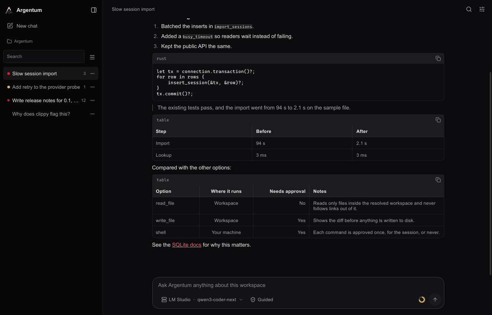
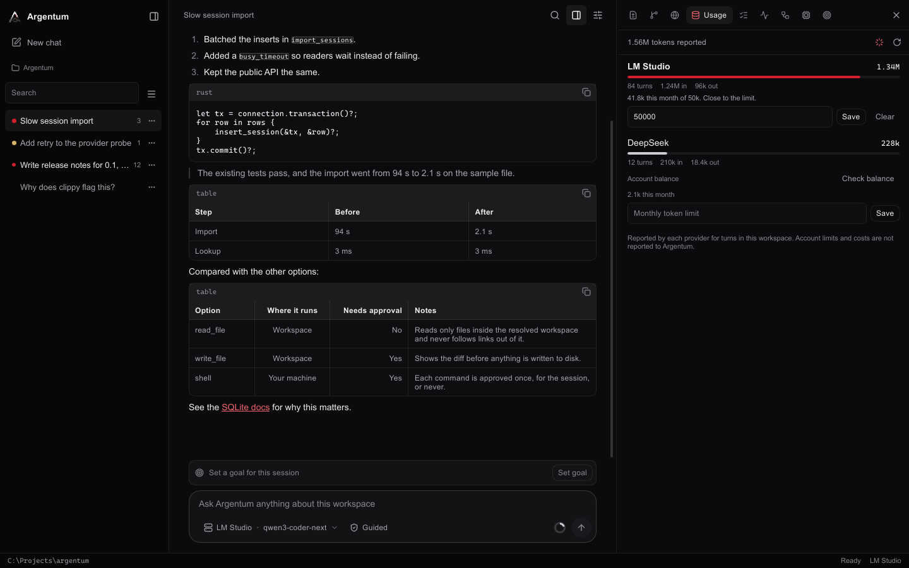

# Compaction and budgets

Every model has a limit on how much text it can take in at once, its context.
Long sessions fill it. Argentum gives you three tools to stay in control: the
context meter, compaction, and token limits.

## Watch the context meter

Turn on the **Context meter** module in Settings > Modules. It is the ring next
to the send button. It shows how full the context was on the latest turn, and the tokens the
session used, when the provider reports them. Hover over it for
the numbers. It turns amber, then red, as the context fills.



## Compact a session

Compaction replaces the older part of the conversation with a summary, so the
session can go on with room to spare.

- **In the app:** open Settings > Diagnostics, find **Context**, press
  **Compact**, then **Confirm**. Turn on **Turn compaction off afterwards** if you
  want the full history back for the next turn.
- **In `argentum chat`:** type `/compact`. `/compact deactivate` turns the summary
  off without calling a model.

Compaction uses the selected model, so it uses tokens too. A manual compaction does
not count against a [goal](goals.md) unless you run
`argentum compact --goal GOAL_ID --json`.

## Set the model's token budget

Each model needs a token budget before it can run. For models whose context limit
Argentum knows, such as DeepSeek and MiniMax M2, it is set for you. For any other
model, set it in Settings > Providers, or from the command line:

```powershell
argentum provider budget PROFILE_ID --limits TOTAL,INPUT,MAX_OUTPUT,REQUESTED_OUTPUT,UNCERTAINTY
```

The five values are the total context, the input limit, the maximum output, the
requested output and a margin for counting error. Take them from your provider's
documentation. A budget belongs to one profile, model and address, so set it
again when you change the model.

## Set a monthly token limit

The **Usage** module shows the tokens each provider reported this calendar month
(UTC), and takes a monthly token limit per provider.



1. Turn on the Usage module and open it.
2. Type a number in **Monthly token limit** next to the provider and press
   **Save**.
3. From 80% of the limit, the row warns. At the limit, new requests to that
   provider stop with `spend_limit_reached` until next month, or until you raise
   the limit or press **Clear**.

The limit is in tokens, not money, and counts replies and compaction summaries.
It is stored per project and provider. It cannot be set over JSONL or from a
paired device.
