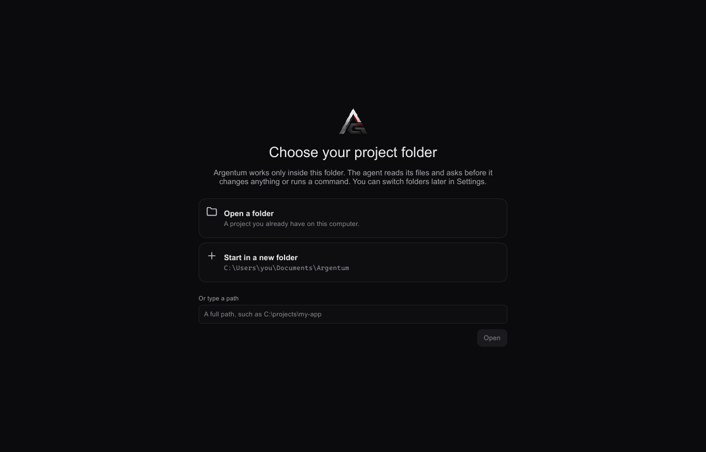
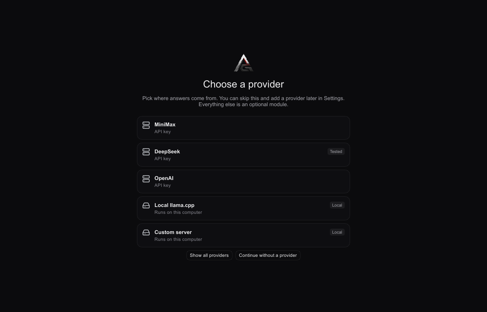

# First run and the project folder

On the first start, Argentum asks three things: which folder to work in, which
provider to use, and which modules to show. Only the folder is required.

## 1. Choose the project folder

Pick one:

- **Open a folder you have**, such as a Git checkout of your project.
- **Start in a new, empty folder.** Argentum creates an `Argentum` folder in
  Documents.
- **Type a path.**

Nothing runs and nothing is saved until you choose. The agent never works in the
folder the app was started from, such as its install folder. File tools stay
inside the folder you choose.

To change it later, open Settings > Workspace.

On Android this step is skipped: the app starts in its own folder. See
[install on Android](install/android.md) to use a shared folder.

## 2. Choose a provider

The short list shows the tested providers, local llama.cpp and a custom server.
**Show all providers** opens the rest. If the provider needs a key, Argentum asks
for it next. See [choose and add a provider](providers.md).

**Continue without a provider** skips this step. You can add one later in
Settings > Providers.

## 3. Pick modules, or skip

New projects start in the Minimal set: a conversation, the model chooser and the
approval prompt. You can pick a larger set now or go straight to the conversation.
See [modules](modules.md).

## Send a first message

Type a request in the composer, for example "Summarize what this project does".
Reading files inside the folder is allowed by default. When the agent wants to
change a file or run a command, it asks first. See
[project policy and approvals](policy-and-approvals.md).
