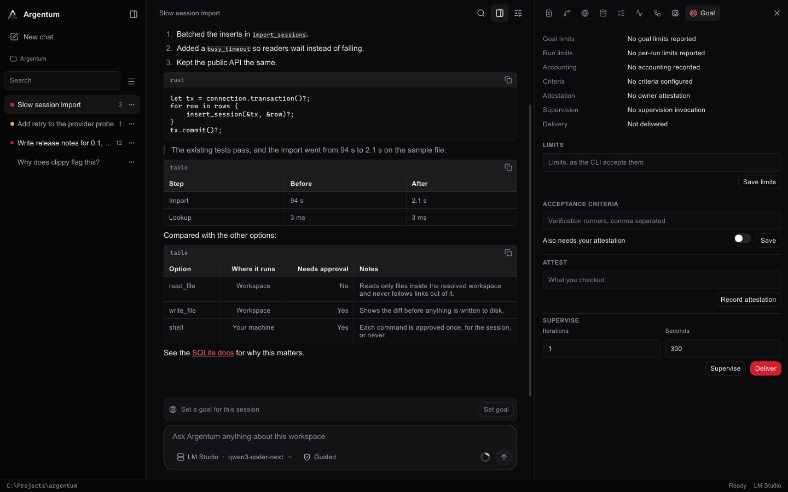
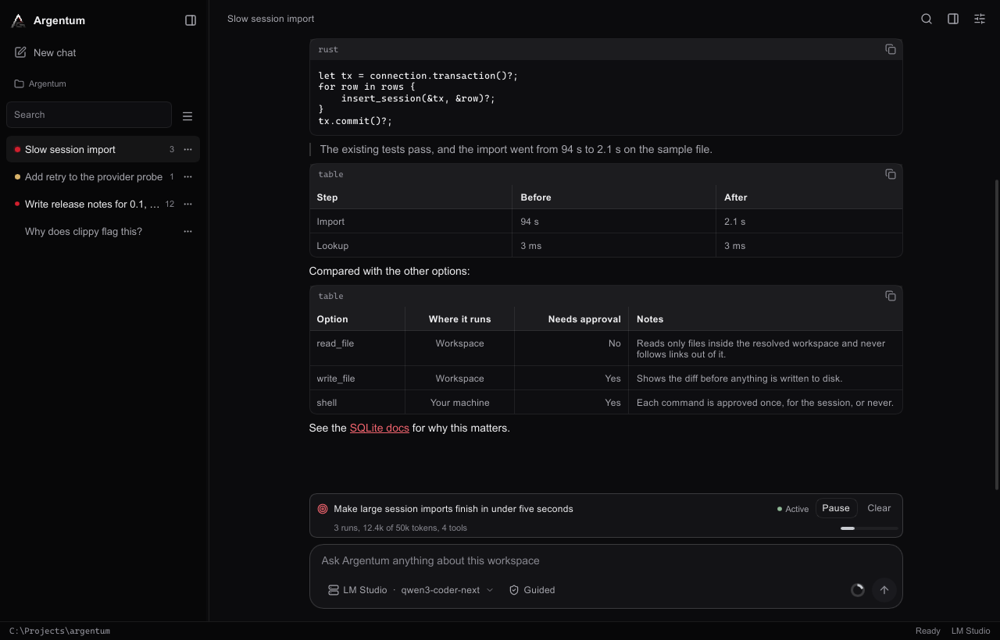

# Goals

A goal gives a session one objective and a set of limits, so the agent can work on
a larger task across several runs. Argentum counts the tokens, model requests,
tool calls and time those runs use, and stops work when a limit is reached.

A run that ends is not the same as a goal that is done. A goal is done only when
your checks pass, or when you confirm it.

## Set a goal in the app

1. Turn on the **Goal** module in Settings > Modules. A bar appears above the
   composer.
2. Type the objective in **Set a goal for this session**, for example "Make large
   session imports finish in under five seconds", and press **Set goal**.
3. Optional: open the Goal panel to set limits, acceptance checks and supervision.
   Limits use the same nine numbers as `argentum goal limits`, described in the
   full guide linked below.

   

4. Send tasks as usual. While the goal is active, each task counts against it, and
   the bar shows the runs, tokens and tool calls used so far.

   

Use **Pause**, **Resume** and **Clear** on the card. Pausing and resuming never
start work by themselves. Clearing archives the goal.

## Set a goal from the command line

```powershell
argentum goal set --objective 'Migrate the parser and keep the tests passing' --token-budget 1000000 --tool-budget 200 --time-budget 3600
argentum run --goal GOAL_ID --prompt 'Start with the lexer' --json
argentum goal status --json
```

`--time-budget` is in seconds. In `argentum chat`, use `/goal-run GOAL_ID TASK`.

## When a goal stops

The card, or `goal status`, says why. Common reasons:

| Reason | What to do |
| --- | --- |
| `goal_budget_exhausted` | Raise the token limit, or end the goal |
| `goal_tool_limit` | Raise the tool call limit |
| `goal_deadline_exceeded` | Raise the time limit. Work done so far is kept |
| `goal_usage_unresolved` | A request never reported its usage. See the full guide |

Raising a limit never resets what the goal has used. Limits can only narrow what
the project policy allows. They never grant more, and the model cannot raise them.

Checks, supervision and delivery are in
[Goals](https://github.com/AG064/argentum/blob/development/docs/GOAL_ACCOUNTING.md)
and [Staged goal delivery](https://github.com/AG064/argentum/blob/development/docs/NATIVE_DELIVERY.md).
