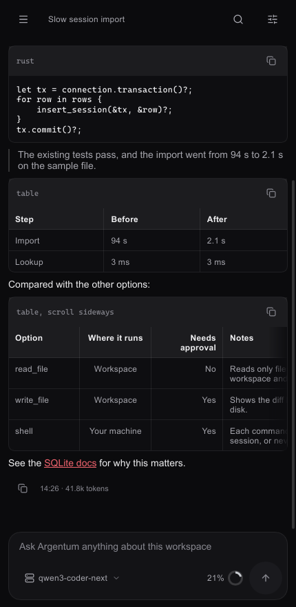

# Install on Android

You need Android 9 or later on a 64-bit ARM phone or tablet. Argentum is
distributed as an APK from GitHub, not from Google Play.

## Steps

1. On the phone, open the
   [latest release](https://github.com/AG064/argentum/releases/latest) and
   download `Argentum-0.1.0-android-arm64.apk`.
2. Open the file. When Android asks, allow your browser or file manager to install
   apps.
3. Start Argentum. It opens in its own private folder, so there is no project
   folder to choose.
4. Pick a provider and paste its key, or pick **OpenAI compatible** to use a model
   server on your computer. See [choose and add a provider](../providers.md).

## Work in a shared folder

By default the agent works in the app's own folder, which other apps cannot see.
To work in a folder such as one under Documents:

1. Open Settings > Workspace and tap **Turn on in Android settings**. Turn on All
   files access for Argentum and come back.
2. Tap **Choose folder** and pick a folder under Internal storage, or type a path
   such as `/storage/emulated/0/Documents/my-app`.
3. Tap **Open** and restart. Argentum opens again in that folder.

The agent still stays inside the chosen folder, with the same approvals as on a
computer. SD cards, USB drives, Downloads, cloud folders, the whole of Internal
storage and anything under `Android/` are refused.

## Good to know

- The local model add-on is not in the Android app. Use a hosted provider, or a
  model server on your computer over your local network.
- Shell commands run with the phone's built-in shell, with the same approvals as
  on Windows. Scripts in shared storage run as `sh script.sh`.
- To check the APK signer, run `apksigner verify --print-certs FILE`.

More detail is in
[Argentum on Android](https://github.com/AG064/argentum/blob/development/docs/ANDROID_HOST.md).
