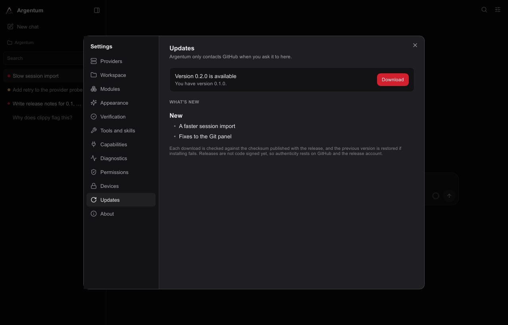

# Install on Windows

You need Windows 11, 64-bit. Nothing else needs installing: no Visual C++ runtime,
no administrator rights. Git is only needed for the Git diff module.

## Steps

1. Open the [latest release](https://github.com/AG064/argentum/releases/latest).
2. Download `Argentum-0.1.0-windows-x64.msi`, and `SHA256SUMS.txt` if you want to
   check the file.
3. Optional: check the download in PowerShell and compare the result with the line
   for the file in `SHA256SUMS.txt`:

   ```powershell
   Get-FileHash .\Argentum-0.1.0-windows-x64.msi
   ```

4. Run the installer. It installs for your account only.
5. Windows SmartScreen may warn the first time, because the files are not code
   signed yet. Choose **More info**, then **Run anyway**.
6. Start Argentum from the Start menu. Continue with
   [first run and the project folder](../first-run.md).

## Other downloads

| File | When to use it |
| --- | --- |
| `Argentum-0.1.0-windows-x64.zip` | The app without installing. Unzip it anywhere and run it |
| `argentum-genesis-0.1.0-windows-x64.zip` | Only the command-line agent. See [the command line](../cli.md) |
| `argentum-genesis-desktop-control-0.1.0-windows-x64.zip` | The command-line agent with Windows desktop control, extensions and MCP |

To check where a file was built, run
`gh attestation verify FILE --repo AG064/argentum`.

## Updating later

Settings > Updates checks GitHub only when you click **Check for updates**. It
verifies the download against the release checksums and rolls back if installing
fails.



Tested systems and requirements are in
[systems, requirements and support](https://github.com/AG064/argentum/blob/development/docs/SUPPORT_MATRIX.md).
