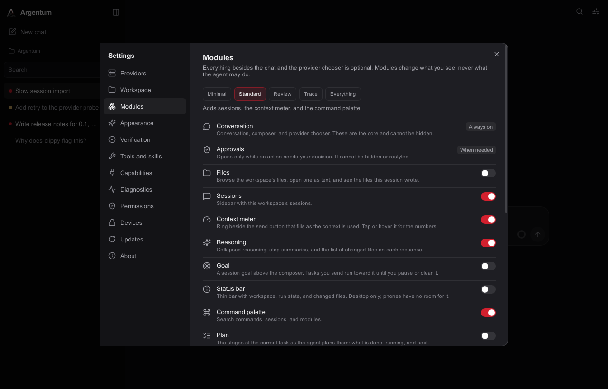
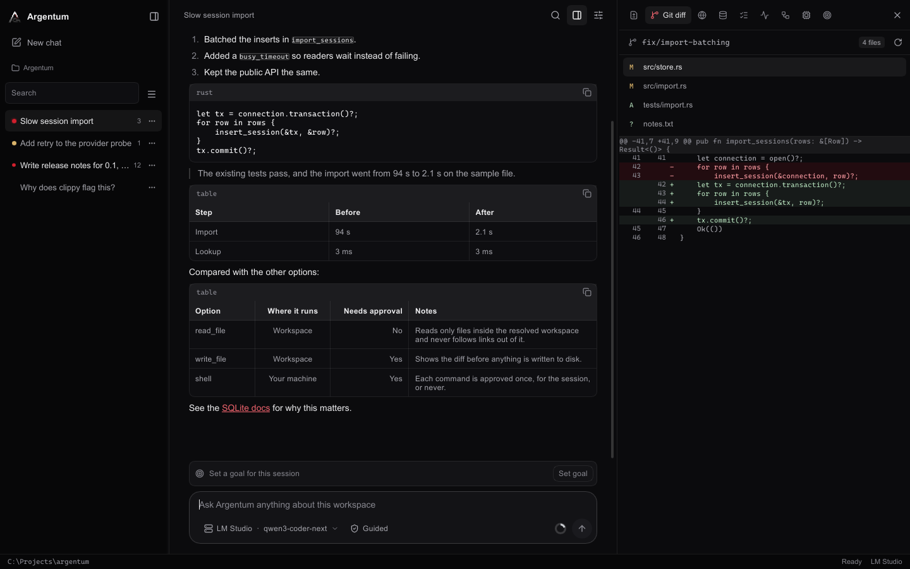
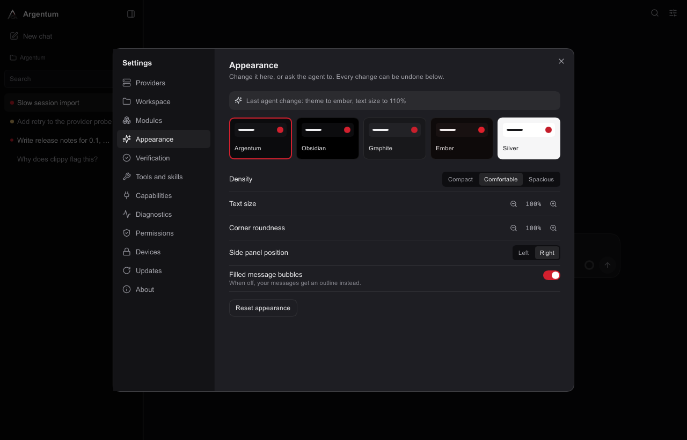

# Modules

Argentum starts small: a conversation, the model chooser and the approval prompt.
Everything else is a module you turn on when you want it.

## Turn modules on

1. Open Settings > Modules.
2. Pick a set, or switch modules one by one.

| Set | What it includes |
| --- | --- |
| Minimal | The conversation, the provider chooser and collapsed reasoning. The default |
| Standard | Adds sessions, the context meter and the command palette |
| Review | Standard plus agent changes and the Git diff |
| Trace | Standard plus the saved trajectory and each model request |
| Everything | Every module this build includes |

The Modules page shows exactly what each set includes.

## The modules

| Module | What it adds |
| --- | --- |
| Sessions | A sidebar with this project's sessions, search, rename, pin, archive and fork |
| Context meter | How full the context is. See [compaction and budgets](compaction-and-budgets.md) |
| Reasoning | Each step's thinking, a summary and the changed files |
| Goal | A session objective with limits. See [goals](goals.md) |
| Command palette | Ctrl+K search over commands, modules, themes and sessions |
| Status bar | Project, run state, changed files and provider. Desktop only |
| Changes | Files the agent changed, with a diff and restore for each |
| Git diff | Working tree status and diffs from Git |
| Usage | Tokens reported per provider, and monthly limits |
| Activity | A live list of requests, tools, approvals and checks |
| Trajectory | The saved record of one session |
| Requests | Every model request in the session, with timing and what filled its context |

## A module never grants permission

Turning a module on changes what you see, not what the agent may do. For example,
Git diff runs `git` only after you click, and only when the project policy allows
`git.read`. See [project policy and approvals](policy-and-approvals.md).

## Make it yours

Settings > Appearance has five themes (Argentum, Obsidian, Graphite, Ember and
Silver), text size, density, corner roundness, panel side, colors and fonts.

The agent can change the interface too, with its `ui_update` tool. Every change
asks first and can be undone. It cannot change permissions or the approval prompt.

More detail is in
[Interface modules](https://github.com/AG064/argentum/blob/development/docs/UI_MODULES.md).
