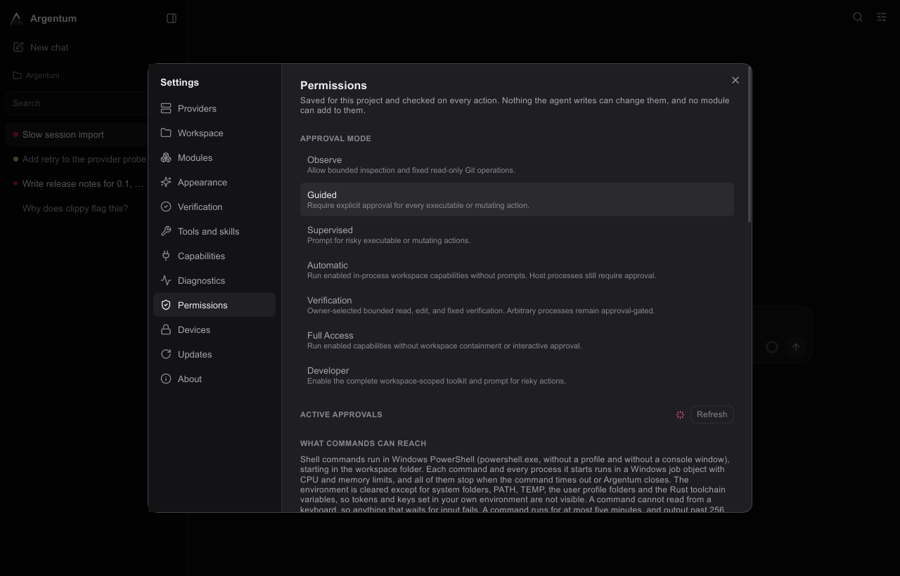
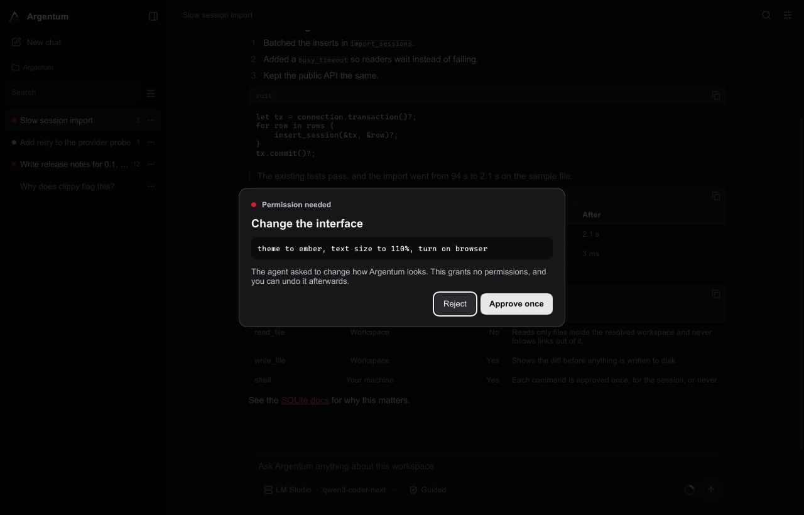
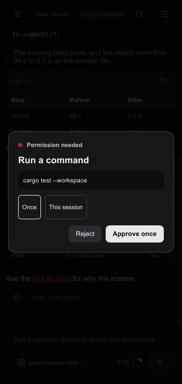

# Project policy and approvals

Each project has a saved policy. It decides what the agent may do, and it is
checked on every action. Nothing the model writes, no prompt, tool result or web
page, and no module can change it or add to it.

## Pick an approval mode

Open Settings > Permissions and choose a mode under **Approval mode**. The current
mode is also shown next to the model in the composer.

| Mode | What it does |
| --- | --- |
| Observe | Reading and fixed read-only Git operations only |
| Guided | Asks before every command and every change. The default |
| Supervised | Asks before risky commands and changes |
| Automatic | Runs workspace tools without asking. Starting other programs still asks |
| Verification | Reading, editing and the fixed verification runners you chose. Other programs still ask |
| Developer | The full set of workspace tools, and asks before risky actions |
| Full Access | Runs enabled tools without folder limits or prompts |

Only you can choose Full Access, in the app or at the local command line. Paired
devices and scripts cannot. Operating-system permissions still apply.

## Answer an approval

When the agent wants to do something the mode does not allow on its own, the
approval prompt opens. It shows the exact action, its target and why it is needed.

1. Read the action and target. For a shell command, the full command is shown, with
   hidden control characters written out.
2. Pick how far the approval reaches, for example **Once** or **This session**.

   

3. Press **Approve once** (or **Approve** for a wider scope), or **Reject** to
   refuse.

An approval covers the exact action it was given for. A changed command, argument
or path needs a new one. The approval prompt always shows above everything else
and cannot be hidden or restyled by the agent.

## Take a grant back

Settings > Permissions lists the grants you have given under **Active approvals**.
Revoke any of them there.

## What stays fixed in every mode

- File tools stay inside the project folder. Paths that leave it, or pass through
  a symbolic link, are refused.
- The agent has no general network tool. It reaches the network only through
  the provider you chose.
- Git has no push, merge, rebase, reset, tag or remote commands.

See the [security model](security.md) for the full picture.
