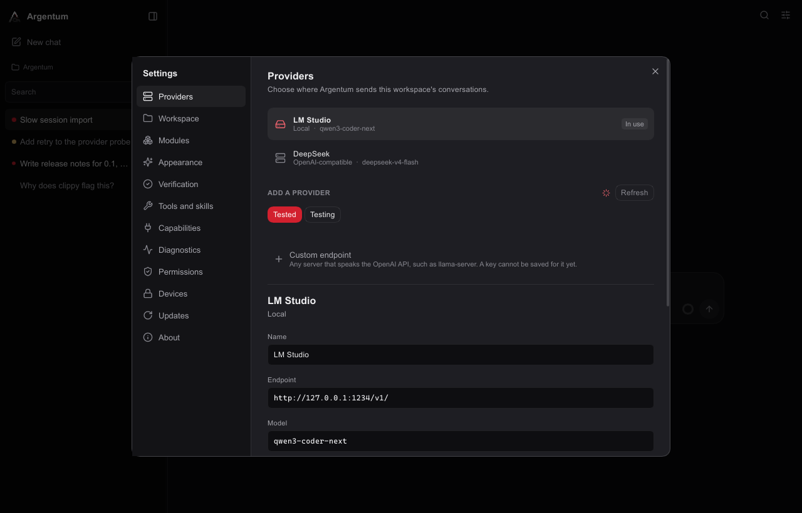
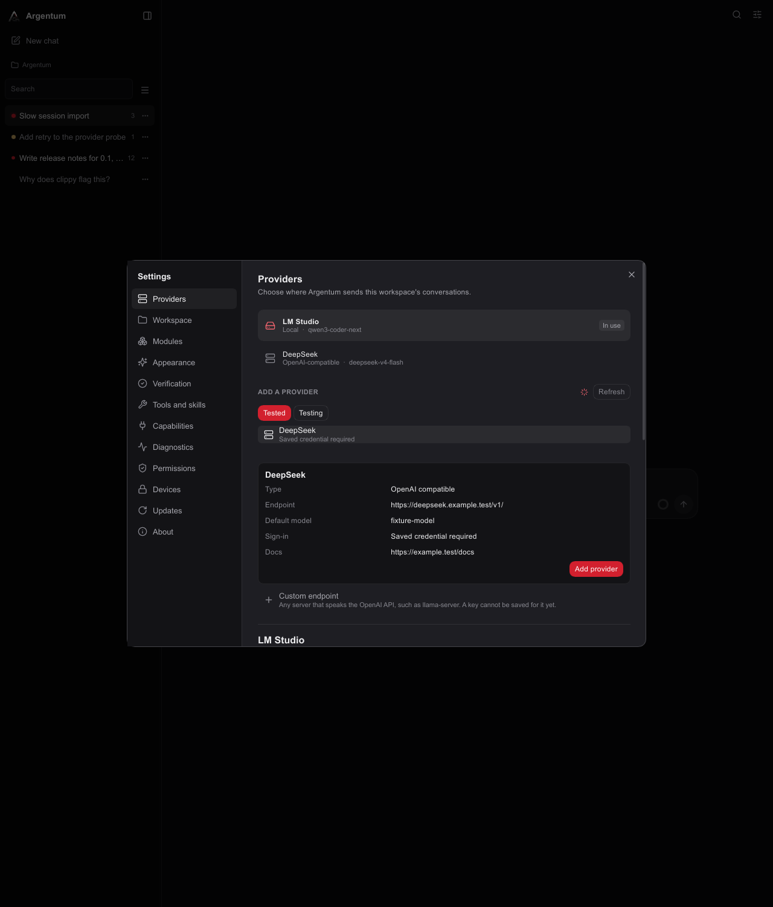
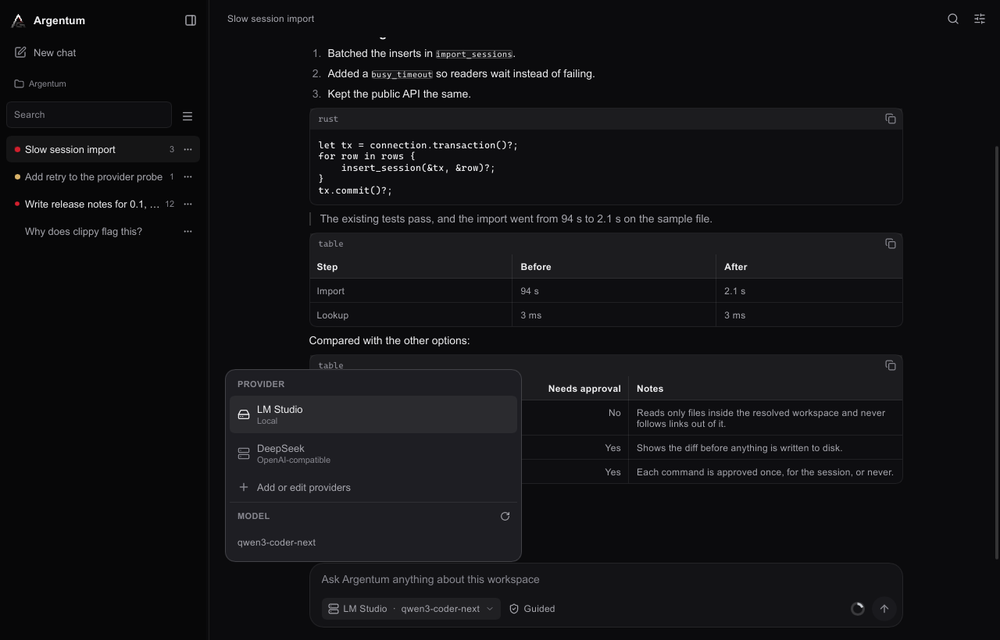

# Choose and add a provider

A provider is the service that runs the model: a hosted API such as DeepSeek, an
aggregator such as OpenRouter, a server on your computer, or any
OpenAI-compatible server. Argentum has more than 40 presets.

## Which one to pick

- **Tested with Argentum:** DeepSeek (Windows and Android) and OpenCode Go
  (Windows).
- **Supported, not yet tested:** Anthropic, OpenAI, Azure OpenAI, Google Gemini,
  OpenRouter, Groq, Mistral, xAI and the other hosted entries. They are listed on
  the Testing tab.
- **On your computer:** llama.cpp, LM Studio, Ollama and vLLM. See
  [run a local model](local-models.md).
- **Not supported:** Amazon Bedrock and Google Vertex AI, because they need a cloud
  sign-in instead of an API key.

The model must support tool calling to work as a coding agent.

## Add a provider in the app

1. Open Settings > Providers.

   

2. Pick a preset from the catalog. **Show all providers** lists every entry.

   

3. Paste the API key when asked. The key goes straight to Windows Credential
   Manager or the Android Keystore, and the field is cleared. A key is only ever
   sent to its own provider's address.
4. Choose a model with the model chooser next to the composer.

   

## Add a provider from the command line

```powershell
argentum provider presets
argentum provider add deepseek
argentum provider credential set deepseek
argentum provider select deepseek
```

`provider credential set` reads the key from standard input. You can also set the
environment variable listed for the preset, such as `DEEPSEEK_API_KEY`. Never put a
key in a command line.

## Your own server

Choose **OpenAI compatible** and give its address, model name and context size.
Keys are stored only for the presets, so this works with servers that need no key.

Every preset, with its address, default model and key variable, is in
[Providers](https://github.com/AG064/argentum/blob/development/docs/PROVIDERS.md).
ChatGPT plans use a browser sign-in from the command line:
[ChatGPT sign-in](https://github.com/AG064/argentum/blob/development/docs/CHATGPT_SIGN_IN.md).
